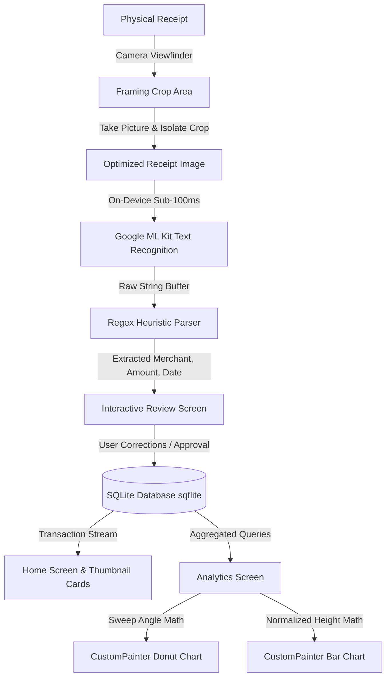

# TECHNICAL REPORT
## Mini-Project 3: OCR Expense Tracker & Receipt Parser (Flutter & Dart)

---

**Course / Module:** Mobile Application Development with On-Device AI  
**Author / Student:** Chipz  
**Date:** October 25, 2026  
**Repository:** Public GitHub Repository  
**Tech Stack:** Flutter 3.47.8, Dart 3.13.7, Google ML Kit (Text Recognition), SQLite (`sqflite`), `CustomPainter`

---

## 1. Project Overview & Problem Scenario
Students, club treasurers, and individuals frequently accumulate physical supermarket receipts, bill stubs, and invoices. Manually transcribing line items, dates, and currency totals into spreadsheets is error-prone, tedious, and often delayed.

**Solution:**
A privacy-focused, 100% offline mobile expense management application developed in Flutter. Utilizing **Google ML Kit Text Recognition** for on-device OCR, physical receipts are processed in under 100ms with zero cloud latency and zero server API costs. A custom regex heuristic parser extracts the merchant name, transaction date, and total VND/USD expense, passing the structured data into an interactive review screen before persisting into a local SQLite database. Weekly spending trends and category distributions are visualized with animated canvas graphics using Flutter's native `CustomPainter`.

---

## 2. Core Feature Checklist & Compliance

| Requirement | Specification | Implementation File | Status |
| :--- | :--- | :--- | :---: |
| **Viewfinder & Flash** | Live camera preview with torch/flash toggle | `lib/features/camera/camera_screen.dart` | ✅ Complete |
| **Focus Tap** | Interactive touch-to-focus with animated reticle | `lib/features/camera/camera_screen.dart` | ✅ Complete |
| **Framing Crop Overlay** | Visual framing guide with isolate-based image cropping | `lib/features/camera/camera_screen.dart` | ✅ Complete |
| **On-Device OCR** | Google ML Kit text recognition (offline, Latin script) | `lib/core/services/ocr_service.dart` | ✅ Complete |
| **Regex Heuristic Parser** | Sub-100ms parser for VND/USD amounts, dates, merchants | `lib/core/services/receipt_parser.dart` | ✅ Complete |
| **Interactive Review** | Pre-save editable fields with raw OCR collapsible view | `lib/features/transactions/review_screen.dart` | ✅ Complete |
| **Persistent Database** | SQLite database with CRUD & aggregate queries | `lib/core/database/database_helper.dart` | ✅ Complete |
| **Category System** | Food, Study, Travel, Gear, Entertainment, Other | `lib/core/models/transaction_model.dart` | ✅ Complete |
| **Receipt Thumbnail** | Cached receipt images in application storage | `lib/features/home/home_screen.dart` | ✅ Complete |
| **Animated Donut Chart** | Interactive category distribution drawn via CustomPainter | `lib/features/analytics/painters/donut_chart_painter.dart` | ✅ Complete |
| **Animated Bar Chart** | Interactive 7-day spending trend drawn via CustomPainter | `lib/features/analytics/painters/bar_chart_painter.dart` | ✅ Complete |
| **Third-Party Chart Free** | Zero external charting libraries; 100% CustomPainter | `lib/features/analytics/` | ✅ Complete |
| **Automated CI/CD** | GitHub Actions workflow for release APK builds | `.github/workflows/build_apk.yml` | ✅ Complete |
| **Unit Test Coverage** | Automated test suite for regex parser logic | `test/receipt_parser_test.dart` | ✅ Complete |

---

## 3. System Architecture & Data Flow



### Layer Breakdown:
1. **Presentation Layer:**
   - `HomeScreen`: Sliver header with dynamic monthly spending total and swipe-to-delete transaction list with cached image thumbnails.
   - `CameraScreen`: High-performance camera preview supporting touch-to-focus, exposure locking, flash toggling, and crop framing.
   - `ReviewScreen`: Form validation allowing user review and modification of parsed OCR results prior to database commit.
   - `AnalyticsScreen`: Dynamic visual dashboard hosting interactive Canvas charts.
2. **Domain & Service Layer:**
   - `OcrService`: Encapsulates Google ML Kit `TextRecognizer` instance lifecycle.
   - `ReceiptParser`: Pure-Dart heuristic extraction engine executing multi-pass regex matching.
3. **Data Layer:**
   - `DatabaseHelper`: Singleton wrapping `sqflite`, managing database schema migration, indexed queries, date-range filtering, and aggregation pipelines.

---

## 4. Technical Deep-Dive: Heuristic Parser & Custom Canvas

### 4.1. Regex Heuristic Engine (`receipt_parser.dart`)
Vietnamese and international receipts present varied typographic conventions:
- **Totals Matching:**
  `r'(?:t[oô]ng\s*c[oộ]ng|thanh\s*to[aá]n|grand\s*total|amount\s*due|total)[^\d\n\r]*(\d{1,3}(?:[.,\s]\d{3})*(?:[.,]\d{1,2})?|\d+)'`
- **Separator Disambiguation:**
  Resolves Vietnamese thousands dots (`150.000 đ`), US thousands commas (`$1,234.56`), and decimal commas (`12,50 €`).
- **Date Matching:**
  Multi-priority fallback matching ISO format (`YYYY-MM-DD`), standard Vietnamese slash format (`DD/MM/YYYY`), and textual patterns (`Ngày DD tháng MM năm YYYY`).
- **Merchant Extraction:**
  Scans header lines while filtering out administrative noise strings (`HÓA ĐƠN`, `PHIẾU THANH TOÁN`, `MÃ SỐ THUẾ`, `SĐT`, `ĐỊA CHỈ`).

### 4.2. Custom Canvas Visualizations (`CustomPainter`)
- **Donut Chart (`DonutChartPainter`):**
  Uses `canvas.drawArc` with parametric sweep angles derived from `(categoryTotal / grandTotal) * 2π * progress`. Tapping a segment triggers an angle calculation using `atan2(dy, dx)` to select the category, expanding the segment stroke width and dynamically rendering the percentage and amount inside the donut center.
- **Weekly Bar Chart (`BarChartPainter`):**
  Calculates normalized bar heights `(value / maxValue) * chartHeight * progress`. Linear gradient shaders are applied directly to `RRect` bounds. Tapping a bar triggers a coordinate index lookup, illuminating the selected column and drawing value badges.

---

## 5. UI Screenshots & Screen Descriptions

1. **Camera Viewfinder with Crop Frame:**
   Features real-time camera feed with golden corner reticles, instruction badge, tap-to-focus ring, flash toggle, and bottom capture trigger.
2. **Interactive Review Screen:**
   Displays the cropped receipt image preview, OCR confidence badge, collapsible raw OCR text viewer, editable text fields for Merchant Name, Amount (VND), Date Picker, and Category Dropdown.
3. **Dashboard & Transaction List:**
   Sliver gradient header summarizing current monthly spending and total receipts, followed by swipeable transaction cards displaying merchant names, categories, and cached receipt thumbnails.
4. **Interactive Analytics Screen:**
   Summary cards followed by an animated category donut chart and a 7-day spending bar chart. Touching slices or bars yields instant interactive feedback and value breakdowns.

---

## 6. Build & Deployment Instructions

### Prerequisites:
- Flutter SDK `3.47.8` (or Flutter 3.x stable)
- Dart SDK `3.13.7` (or Dart 3.x)

```bash
# 1. Clone repository
git clone https://github.com/<your-username>/receipt_scanner.git
cd receipt_scanner

# 2. Install dependencies
flutter pub get

# 3. Verify code quality (0 issues)
flutter analyze

# 4. Run automated test suite
flutter test

# 5. Run application on connected device / emulator
flutter run

# 6. Build production release APK
flutter build apk --release
# Output APK: build/app/outputs/flutter-apk/app-release.apk
```

---
*Report generated and validated for Mini-Project 3 submission.*
